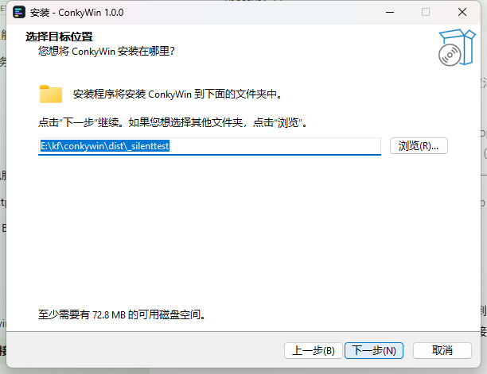
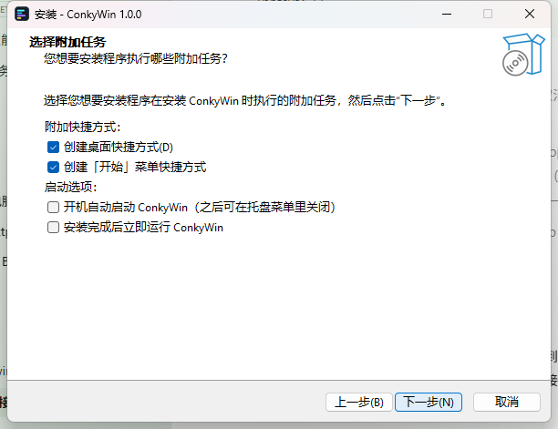
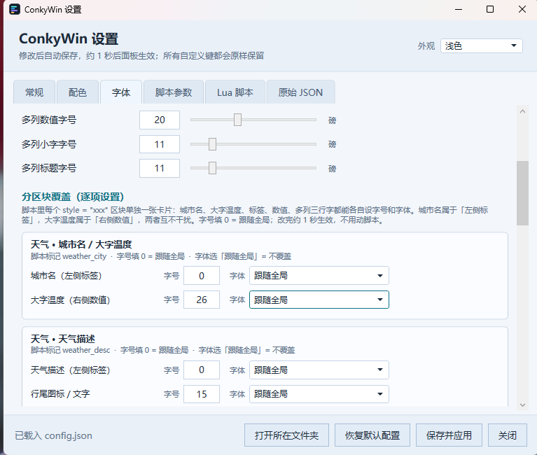

# ConkyWin

Windows 版 [Conky](https://github.com/brndnmtthws/conky) 式桌面系统监控挂件。背景 100% 透明、数据直接悬浮在桌面上，**嵌入桌面层**（不置顶、不挡鼠标、不抢焦点），支持开机自启。

纯 C# / WPF 实现，零第三方监控软件依赖（不需要 Rainmeter、LiteMonitor 等），单文件运行；发行包约 63 MB 是因为自带 .NET 8 运行时，框架依赖编译版仅约 1 MB。


## 功能

| 行      | 内容                       | 数据来源                    |
| ------ | ------------------------ | ----------------------- |
| SYSTEM | 时钟 HH:mm:ss              | 系统时间                    |
| CPU    | 占用率 + 渐变进度条              | Performance Counter     |
| MEM    | 已用 / 总量 + 进度条            | `GlobalMemoryStatusEx`  |
| DISK   | 每个固定磁盘：占用率 + 已用 / 总量 + 用量条（脚本版） | `DriveInfo`             |
| NET    | ↓下行 ↑上行 速率（>1M 自动显示 M）   | `NetworkInterface` 流量差分 |
| GPU    | 占用率 / 显存 / 温度 + 进度条      | `nvidia-smi`（每 2 秒采样）   |
| TEMP   | CPU 温度（普通权限不可读，显示 `--℃`） | 见下方"已知限制"               |
| PROC   | 进程数                      | Performance Counter     |

> **多盘监控已完成**：发行包自带的 `script.lua` 通过 `conky.disks()` 为每个固定磁盘单独生成一条用量条（占用 ≥75% 琥珀色、≥90% 红色告警），插上新盘自动出现，不需要任何配置。上表描述的是删掉脚本后的内置简洁面板，它只显示系统盘（C:）。

## 特性

- **真透明**：WPF per-pixel alpha，无任何底板
- **点击穿透 + 压底**：`WS_EX_TRANSPARENT | WS_EX_LAYERED`，嵌入桌面层（壁纸之上、图标之下），鼠标可正常操作下方图标；每 15 秒自动校正 Z 序，防止被其他程序顶掉
- **不抢焦点 / 不进任务栏**：`WS_EX_TOOLWINDOW`
- **配置热重载**：配置目录下的 `config.json` 和 `script.lua` 保存后立即生效，无需重启（轮询修改时间实现，兼容"写临时文件再改名"的编辑器保存方式）；解析失败自动保留上一份有效配置。便携版配置目录是 exe 同目录，安装版是 `%LOCALAPPDATA%\ConkyWin`
- **无 GPU 也能跑**：NVIDIA GPU 检测失败时静默降级，其余各行不受影响
- **多盘监控**：Harmattan 脚本枚举所有固定磁盘，每盘一条用量条并按占用率变色，5 秒采样
- **Lua 脚本扩展**：可自定义每行文本/配色/进度条，甚至整面板由脚本生成（见下文）
- **配置透传**：config.json 整表（含任意自定义键）通过 `conky.config()` 供脚本读取——改配置即改脚本参数，不用动代码

## 运行要求

- Windows 10 / 11（x64）
- **无需安装 .NET**：安装版与便携版都是自包含单文件，.NET 8 运行时已打包进 exe（约 70 MB）
- （可选）NVIDIA 显卡 + `nvidia-smi`，用于 GPU 那一行；没有则自动跳过，其余功能不受影响

> 从源码编译运行才需要 [.NET 8 SDK](https://dotnet.microsoft.com/download/dotnet/8.0)。

## 快速开始

每个 Release 提供两个包，任选其一（国内推荐 Gitee，速度更快）：  
[Gitee Releases](https://gitee.com/danmyleo/conkywin/releases) · [GitHub Releases](https://github.com/danmy-liu/conkywin/releases)

**方式 A：安装版（推荐）`ConkyWin-x.x.x-setup.exe`**

1. 双击运行，全中文向导里可以**自定义安装位置**（默认 `%LOCALAPPDATA%\Programs\ConkyWin`，无需管理员权限；向导里也能切换成「为所有用户安装」）
2. 「选择附加任务」页可勾选：创建桌面快捷方式、创建开始菜单快捷方式、开机自动启动、安装完成后立即运行
3. 完成后桌面面板透明常驻，**任务栏托盘区出现 ConkyWin 图标**，双击打开设置窗口；桌面另有「ConkyWin 设置」快捷方式可直接打开配置界面
4. 卸载走「设置 → 应用」或开始菜单的卸载入口，卸载时会询问是否保留个人配置（默认保留）





**方式 B：绿色便携版 `ConkyWin-x.x.x-win-x64.zip`**

1. 解压到任意目录（建议固定位置，如 `D:\Tools\ConkyWin`——开机自启要用这个路径）
2. 双击 `ConkyWin.exe`，面板出现在屏幕右侧，托盘区出现 ConkyWin 图标
3. **双击托盘图标**打开可视化设置窗口，改样式所见即所得；也可以直接编辑 `config.json` / `script.lua`，保存即生效
4. 不想要脚本版面板：在设置窗口的「Lua 脚本」页清空内容，或删除 `script.lua`，立刻回到内置简洁面板（7 行，带进度条）

### 两种包的配置文件位置

|                                   | 安装版                       | 便携版               |
| --------------------------------- | ------------------------- | ----------------- |
| 程序文件                              | 自定义的安装目录                  | 解压目录              |
| `config.json` / `script.lua` / 日志 | `%LOCALAPPDATA%\ConkyWin` | exe 同目录           |
| 升级                                | 覆盖安装，**不会覆盖**改过的配置和脚本     | 手动替换 exe，配置文件原样保留 |
| 卸载                                | 控制面板 / 开始菜单卸载入口，可选择保留配置   | 直接删目录             |

装到 `C:\Program Files` 时普通权限写不了程序目录，所以安装版把用户可改的文件统一放到 `%LOCALAPPDATA%\ConkyWin`（托盘菜单「打开配置文件夹」直接打开这里），只读的天气图标仍在安装目录。需要换位置可设环境变量 `CONKYWIN_DATA_DIR`。

## 图形化设置（推荐）


托盘图标是主程序唯一的交互入口 —— 主面板点击穿透、不进任务栏，本身点不到。Windows 11 可能把图标收在托盘的「^」里，点开就能看到。

**双击图标**打开设置窗口；**右键**是菜单：

| 菜单项         | 作用                                          |
| ----------- | ------------------------------------------- |
| 打开设置        | 打开可视化配置窗口                                   |
| 重新加载配置与脚本   | 不等轮询，立刻重读 `config.json` / `script.lua`      |
| 打开配置文件夹     | 在资源管理器里定位 `config.json`                     |
| 开机自启        | 勾选/取消，自动维护 `HKCU\...\Run` 注册表项（指向当前运行的 exe） |
| 检查更新        | 查询 Gitee / GitHub 最新 Release 版本号，有新版本时提示并打开发布页（不会自动下载或安装） |
| 退出 ConkyWin | 正常退出并清理托盘图标                                 |

同一时间只会运行一个桌面面板：重复双击 `ConkyWin.exe` 时第二个进程会静默退出，不会叠出两个透明面板。`--settings`（只开设置窗口）和 `--selftest`（自测）不受此限制。

设置窗口六个页签，右上角「外观」下拉可切换 **浅色 / 深色 / 跟随系统**，默认浅色；选法写进 `config.json` 的 `UiTheme`，下次打开还记得。这只影响设置窗口，桌面面板本身是透明的、颜色由脚本 `C` 表决定。深色主题实机效果见 [settings-dark.png](docs/settings-dark.png)。

- **常规**：水平对齐 / 垂直对齐、X/Y、边缘留白、面板宽度、天气城市与经纬度
- **配色**：标签色、进度条底色、7 个模块数值色、CPU/MEM/DISK/GPU 渐变两端；带系统取色器与预览色块，透明度前缀会保留
- **字体**：全局正文字体 / 标签字体 / 时间字体 / 多列字体（下拉直接列出系统已安装字体）及各自字号；下方「分区块覆盖（逐项设置）」按 `script.lua` 里的 `style` 标记自动生成卡片，每类可见文字（城市名、大字温度、标签、数值、多列标题/数值/小字）都有独立的字号与字体控件
- **脚本参数**：`GraphHeight` / `TopProcesses` / `ScaleFloorKb` / `TextColor` / `AccentColor`（Harmattan 脚本的自定义键）
- **Lua 脚本**：主题 `color` / `mono` 切换、语法检查、保存、恢复内置默认脚本
- **原始 JSON**：直接编辑完整 `config.json`，任意自定义键都能改，校验通过才应用

**位置怎么摆**：水平、垂直各有一个对齐下拉，可选 `绝对坐标` / `左对齐` / `水平居中` / `右对齐` 和 `绝对坐标` / `顶部对齐` / `垂直居中` / `底部对齐`。X/Y 永远可填：选「绝对坐标」时是屏幕像素坐标；选对齐方式时变成相对基准的微调偏移（正数向右 / 下，可为负）。从绝对坐标切到对齐方式时窗口会自动把偏移归零，避免旧坐标把面板顶出屏幕。旧配置只有 `RightGap` / `BottomGap`，打开设置窗口时会自动推断出对齐方式，位置不会跳。

**字体与字号怎么改**：全局项是所有区块的默认值，字体下拉列的是本机已安装的字体族，留空表示跟随上一级。想单独调某个区块，在「分区块覆盖（逐项设置）」里找到对应卡片，直接改那一类文字的字号 / 字体，字号填 `0` 表示跟随全局。卡片里的每一行写的是它实际控制的文字：

- 天气首行是**两个独立元素**：`城市名（左侧标签）` → `LabelSize` / `LabelFont`，`大字温度（右侧数值）` → `Size` / `Font`。只改「大字温度」不会动城市名，想让城市名变大就改「城市名」那一行（或改全局「标签字号」）。
- 其它普通行同理：左边标签走 `LabelSize` / `LabelFont`，右边数值走 `Size` / `Font`。
- 多列区块（三天预报）分三行：`CellLabelSize`（今天/明天/后天）、`CellSize`（中间数值或图标）、`CellSubSize`（底部温度小字），列标题字体用 `LabelFont`，数值与小字字体用 `CellFont`。



上图是字体页滚到「分区块覆盖」的实机效果：第一张卡片里，`城市名（左侧标签）` 与 `大字温度（右侧数值）` 各占一行，字号、字体互不干扰。

卡片的区块名是**自动从 `script.lua` 扫描** `style = "xxx"` 得到的 —— 你给脚本里任意一行加上自己的 `style` 名，设置窗口就会自动多出对应卡片，不用改 C#。底层写的是 `config.json` 的 `Styles` 表：

```json
"Styles": {
  "weather_city":     { "Size": 30, "LabelSize": 20, "Font": "KaiTi", "LabelFont": "Microsoft YaHei UI" },
  "weather_info":     { "Size": 14, "LabelSize": 12 },
  "weather_forecast": { "CellSize": 22, "CellLabelSize": 12, "CellSubSize": 12 },
  "graph":            { "LabelSize": 12 }
}
```

上面 `weather_city.LabelSize` 就是城市名字号，`Size` 是大字温度字号。可用键：`Size` / `LabelSize` / `CellSize` / `CellLabelSize` / `CellSubSize` / `Font` / `LabelFont` / `CellFont`。也可以在脚本的行里直接写 `font_size` / `label_font_size` / `font_family` 等字段，行内显式值优先。

**配色以谁为准**：使用 `script.lua` 时，文字和曲线颜色由脚本顶部的 `C` 表决定（`text` 是数值、`label` 是左侧小标签、`cpu`/`mem`/`disk` 是曲线色）。在「配色」「脚本参数」页改颜色，窗口会同步改写 `C` 表；直接在「Lua 脚本」页改 `C` 表同样立即生效，两条路等价。`config.json` 里的 `LabelColor`/`Cpu.ValueColor` 等只用于删掉脚本后的内置简洁面板。

改动在停止操作 700ms 后自动保存，约 1 秒后面板生效；也可以点「保存并应用」立刻写盘。写盘走临时文件 + 原子替换，不会让每秒轮询读到半个 JSON。首次保存会生成 `config.json.bak`，「原始 JSON」页可一键还原。**未知键一律原样保留**，你自己加进 config.json 的自定义键不会被控件删掉。

> 设置窗口开着的时候，如果又在外部编辑器改了 `config.json`，请先点「重新载入」或关掉窗口重开 —— 窗口保存时以它自己载入的那份内容为准。

给桌面快捷方式加 `--settings` 参数，可以只打开设置窗口而不启动面板：`ConkyWin.exe --settings`。开发自测用 `ConkyWin.exe --selftest`，日志写在配置目录（便携版 = exe 同目录，安装版 = `%LOCALAPPDATA%\ConkyWin`）。

### 开机自启（可选）

最简单的做法是勾托盘菜单里的「开机自启」。想手工设置也行，在注册表 `HKCU\Software\Microsoft\Windows\CurrentVersion\Run` 下新建字符串值：

```
名称：ConkyWin
数据：<你的路径>\ConkyWin.exe
```

## 配置文件 config.json

```jsonc
{
  "Position": {
    "X": 0,                               // 绝对坐标下的屏幕横坐标；对齐模式下是相对基准的偏移
    "Y": 0,                               // 绝对坐标下的屏幕纵坐标；对齐模式下是相对基准的偏移
    "HAlign": "right",                    // absolute / left / center / right（留空 = 旧版 RightGap 语义）
    "VAlign": "bottom",                   // absolute / top / center / bottom（留空 = 旧版 BottomGap 钳制）
    "RightGap": 0,                        // 右对齐时距屏幕右缘的留白
    "BottomGap": 8                        // 底部对齐时距屏幕下缘的留白
  },
  "PanelWidth": 220,                     // 面板固定宽度（px），高度自适应内容
  "FontSize": 13,                        // 全局数值字号
  "TimeFontSize": 15,                    // 时间字号
  "Bold": true,                          // 数值是否加粗
  "FontFamily": "Consolas",              // 全局正文字体（填系统已安装的字体名）
  "LabelFontFamily": "Microsoft YaHei UI", // 全局左侧标签字体
  "LabelFontSize": 11,                   // 全局左侧标签字号
  "CellFontSize": 20,                    // 多列区块（三天预报）数值字号
  "CellLabelFontSize": 11,               // 多列区块顶部小字字号
  "CellSubFontSize": 11,                 // 多列区块底部小字字号
  "Styles": {},                          // 分区块覆盖，见「字体与字号怎么改」
  "UiTheme": "light",                    // 设置窗口外观：light / dark / system（跟随 Windows）
  "LabelColor": "#7A90AC",               // 左侧标签颜色（CPU/MEM/...）
  "BarBackground": "#26FFFFFF",          // 进度条底色（半透明）
  "Cpu": {
    "ValueColor": "#4DE3E0",             // 数值颜色
    "BarStart": "#4DE3E0",               // 进度条渐变起点
    "BarEnd": "#2F9EFF"                  // 进度条渐变终点
  },
  "Mem":   { "ValueColor": "#7FB0FF", "BarStart": "#6FA8FF", "BarEnd": "#9B7BFF" },
  "Disk":  { "ValueColor": "#FFC85C", "BarStart": "#FFC85C", "BarEnd": "#FF8A5C" },
  "Net":   { "ValueColor": "#8FD8FF" },
  "Gpu":   { "ValueColor": "#B78CFF", "BarStart": "#B78CFF", "BarEnd": "#7A5CFF" },
  "Temp":  { "ValueColor": "#FF6B6B" },
  "Proc":  { "ValueColor": "#EAF2FC" },
  "Weather": {
    "City": "",                          // 城市名（支持中文，如 "西安"），填了优先用地理编码定位
    "Lat": 999,                          // 经纬度；999 = 自动（先 City，再 IP 定位）
    "Lon": 999
  }
}
```

颜色支持 `#RRGGBB` 与 `#AARRGGBB`（带透明度）。`Net` / `Temp` / `Proc` 没有进度条，只需 `ValueColor`。`Weather` 仅在 Lua 脚本调用 `conky.weather()` 时使用。

## Lua 脚本（进阶）

参照 Linux Conky 的思路，ConkyWin 支持 Lua 脚本扩展（基于 [MoonSharp](https://github.com/moonsharp-devs/moonsharp)，纯托管实现，无原生 DLL 依赖）：

1. 把 [`script.example.lua`](script.example.lua)（最小示例）或 [`script.harmattan.lua`](script.harmattan.lua)（复刻 Linux Harmattan 主题：天气大字/图标/三列预报 + 历史曲线 + 累计流量 + 所有磁盘用量条 + Top 进程列表；顶部 `THEME = "color"/"mono"` 一键换肤）复制到配置目录（便携版是 exe 同目录，安装版是 `%LOCALAPPDATA%\ConkyWin`）并改名为 `script.lua`
2. 保存即生效（热重载，无需重启）；删除 `script.lua` 即恢复内置面板

脚本在**安全沙箱**中运行（无 io/os 等模块），出错只写 `debug.log` 并自动回退内置面板，不会导致挂件崩溃。

### 两种模式

**增强模式**——不定义 `conky_rows()`，只定义钩子函数，覆盖内置面板中对应行的文本/颜色/进度条：

```lua
-- CPU 超 90% 数值变红
function conky_cpu_color(pct)
    if pct > 90 then return "#FF5C5C" end
end

-- 内存改显示百分比
function conky_mem_text(used_gb, total_gb, pct)
    return string.format("%.0f%%", pct)
end

-- CPU 进度条超 80% 后渐变转红
function conky_bar_color(name, pct)
    if name == "cpu" and pct > 80 then return {"#FFC85C", "#FF5C5C"} end
end
```

可用钩子：`conky_time_text` / `conky_cpu_text` / `conky_mem_text` / `conky_disk_text` / `conky_net_text` / `conky_gpu_text` / `conky_temp_text` / `conky_proc_text`，以及对应的 `conky_*_color` 与 `conky_bar_color(name, pct)`。

**完整模式**——定义 `conky_rows()` 返回行表，整面板由脚本生成，WPF 按行表动态渲染：

```lua
function conky_rows()
    return {
        { label = "S Y S T E M", text = conky.time("%H:%M:%S"), color = "#8FD8FF" },
        { label = "CPU", text = string.format("%.0f%%", conky.cpu()),
          color = "#4DE3E0", bar = conky.cpu(), bar_start = "#4DE3E0", bar_end = "#2F9EFF" },
        -- ...
    }
end
```

每行字段：`label` / `text` 必填；`color`、`bar`（0-100 进度）、`bar_start` / `bar_end`（渐变两端）、`graph`（0-100 数值数组，历史曲线面积图）、`graph_height`（曲线高度）、`hr`（分隔横线）、`gap`（空白间隔 px，用于分区留白）、`font_size`（本行字号）、`icon`（行尾图片路径，相对 exe 目录或绝对路径）、`icon_size`（默认 20）、`cells`（多列布局，见下）可选。`cells` 的每格同样支持 `icon` / `icon_size`（默认 22）。

仓库自带 [`assets/icons/`](assets/icons) 一套白色单色天气图标（经典 conky weather 图标集，按 weather.com 代码 0-47 编号），脚本可直接引用：`icon = "assets/icons/32.png"`（晴）、`26.png`（多云）、`4.png`（雷雨）等。

`cells` 渲染为一行等宽多列，每格 `{label, text, sub, color}` 三层（顶部小字 / 中间大字 / 底部小字），适合三天预报（星期 / 图标 / 温度）这类并排内容：

```lua
rows[#rows + 1] = {
    cells = {
        { label = "今天", text = "☁︎", sub = "8°/18°" },
        { label = "明天", text = "⛅︎", sub = "6°/16°" },
        { label = "后天", text = "🌧︎", sub = "7°/11°" },
    }
}
```

速率类曲线建议**自适应满格量**（峰值放大、滞后收缩），否则流量几 K 时曲线是条直线——参考 `script.harmattan.lua` 里的 `autoscale()` 实现。

### 自定义配置：conky.config() 透传

config.json 会整体解析成 Lua 表，**包括任何你在里面自定义的键**。脚本可以直接把配置当参数用——改配置即改脚本行为，完全不用动代码：


```lua
local cfg = conky.config()
local floor_kb = cfg.ScaleFloorKb or 16   -- 在 config.json 里加 "ScaleFloorKb": 32 即可覆盖
local top_n    = cfg.TopProcesses or 5
local my_note  = cfg.MyNote               -- 任何键都能读
```

### 脚本可用 API

| 函数                                                                             | 返回                                                                                                                                                                                    |
| ------------------------------------------------------------------------------ | ------------------------------------------------------------------------------------------------------------------------------------------------------------------------------------- |
| `conky.cpu()`                                                                  | CPU 占用 0-100                                                                                                                                                                          |
| `conky.mem_pct()` / `mem_used_gb()` / `mem_total_gb()`                         | 内存                                                                                                                                                                                    |
| `conky.disk_pct()` / `disk_used_gb()` / `disk_total_gb()`                      | C: 盘                                                                                                                                                                                  |
| `conky.disks()`                                                                | 所有固定磁盘数组 `{name="C:", label="系统", pct=62, used_gb, total_gb}`                                                                                                                         |
| `conky.disk_io_kb()`                                                           | 全盘读写速率 KB/s                                                                                                                                                                           |
| `conky.net_down_kb()` / `conky.net_up_kb()`                                    | 网速 KB/s                                                                                                                                                                               |
| `conky.net_total_down_gb()` / `net_total_up_gb()`                              | 开机以来累计收/发流量 GB                                                                                                                                                                        |
| `conky.top_mem(n)` / `top_cpu(n)`                                              | 进程列表 `{name, mem_mb, cpu}`（每 3 秒采样）                                                                                                                                                   |
| `conky.gpu_util()` / `gpu_temp()` / `gpu_mem_used_gb()` / `gpu_mem_total_gb()` | GPU                                                                                                                                                                                   |
| `conky.gpu_available()`                                                        | GPU 是否可用                                                                                                                                                                              |
| `conky.proc()`                                                                 | 进程数                                                                                                                                                                                   |
| `conky.time(fmt)`                                                              | 当前时间（.NET 格式串，如 `"%H:%M:%S"`）                                                                                                                                                         |
| `conky.config()`                                                               | config.json 整表（含自定义键）                                                                                                                                                                 |
| `conky.weather()`                                                              | 天气表 `{city, temp, humidity, wind, pressure, code, daily[3]={code,min,max}}`，数据来自 [Open-Meteo](https://open-meteo.com)（免费无 key）；定位顺序：config 的 Lat/Lon > City > IP 自动定位；成功后有本地缓存，重启不用重等 |
| `conky.weather_error()`                                                        | 最近一次天气获取失败的原因（成功后为空串）                                                                                                                                                                 |
| `conky.font_size()` / `conky.time_font_size()`                                 | config.json 中的字号                                                                                                                                                                      |

**多盘监控怎么用**：`conky.disks()` 返回所有固定磁盘的数组（5 秒采样），每项含 `name`（如 `C:`）、`label`（卷标）、`pct`、`used_gb`、`total_gb`。Harmattan 脚本遍历它为每个盘生成一行用量条，占用 ≥75% 琥珀、≥90% 红色；不需要手写盘符，新增/移除磁盘自动反映。想自定义阈值或只显示某几个盘，改脚本里那段 `for _, d in ipairs(conky.disks())` 即可。

## 编译

需要 .NET 8 SDK：

```powershell
dotnet build ConkyWin.csproj -c Release -o out
```

产物在 `out\ConkyWin.exe`（依赖已安装的 .NET 8 运行时，体积仅 1 MB 左右）。

## 打包发行版（自包含，别人无需装 .NET）

```powershell
powershell -ExecutionPolicy Bypass -File .\build-release.ps1
```

一次产出两个文件（都在 `dist/`）：

| 文件                          | 说明                                               |
| --------------------------- | ------------------------------------------------ |
| `ConkyWin-<版本>-setup.exe`   | 安装版，约 64 MB：中文向导、自定义安装目录、桌面/开始菜单快捷方式、开机自启、控制面板卸载 |
| `ConkyWin-<版本>-win-x64.zip` | 便携版，约 63 MB：解压即用                                 |

便携包内容：

```
ConkyWin.exe     自包含单文件（.NET 8 运行时已打包进去）
config.json      推荐配置（268px 宽 Harmattan 布局）
script.lua       Harmattan 主题脚本（删掉即回内置面板）
portable.flag    便携标记（配置与日志都放 exe 同目录）
assets\icons\    天气图标
README.md / LICENSE
```

安装包由 [Inno Setup](https://jrsoftware.org/isinfo.php) 6.5+ 编译，脚本在 `installer/installer.iss`，简体中文语言文件 `installer/ChineseSimplified.isl`。打包脚本会自动查找编译器；本机没装时会下载官方 6.7.4，以「仅当前用户 / 静默」方式装到 `%LOCALAPPDATA%\ConkyWinBuildTools`，不写系统目录、不需要管理员权限。也可以自己装好后用 `-IsccPath` 指定，或加 `-SkipInstaller` 只出 zip。

两个文件都作为 Release 附件上传即可：Gitee 单个附件上限 100 MB，GitHub 上限 2 GB，64 MB 都在范围内。

### 发版流程

推一个 `v*` 标签，GitHub Actions 会自动在 Windows 上准备 Inno Setup、编译两种包并创建 Release（两个附件自动上传），工作流见 `.github/workflows/release.yml`：

```powershell
# 1. 改 ConkyWin.csproj 里的 <Version>
# 2. 提交并打标签
git commit -am "发布 v1.0.1"
git tag v1.0.1
git push --follow-tags        # 有 github 远程时同步推送
```

Gitee 侧不支持这种自动构建，需要本地跑一次 `build-release.ps1` 再手动上传两个附件（安装包放前面，作为推荐下载项）。

## 关于自动更新

**目前不做自动下载 / 自动安装**，只提供托盘菜单「检查更新」：点一下去 Gitee / GitHub 查最新 Release 的 tag，发现新版本弹提示并打开发布页，下载与安装仍由你决定。

原因：

- 发行包是 64 MB 自包含单文件，安装版由 Inno Setup 管理。自动替换要处理运行中的进程、升级安装、快捷方式、用户配置保留和失败回滚，本身就是一个独立子系统。
- 项目没有代码签名证书。自动下载并执行的 exe 会被 SmartScreen 拦截，缺少签名校验也等于把供应链风险转嫁给用户。
- 个人桌面美化工具的版本节奏慢，手动更新成本很低；常驻网络轮询和后台提权反而更打扰人。

将来若确实要做全自动更新，最小可行方案是：只下载 zip 到临时目录 → 校验随 Release 附上的 SHA256 → 提示用户确认 → 调用 `setup.exe /VERYSILENT` 升级安装到原目录（由 Inno Setup 负责覆盖程序文件与保留配置）→ 重启程序。在这些前提具备之前，不会引入自动更新。

## 已知限制

- **CPU 温度**：普通权限下 Windows 没有可用的读取通道（WMI `MSAcpi_ThermalZoneTemperature` 拒绝访问；真实温度需要 Ring0 内核驱动 + 管理员权限，而管理员权限会破坏本程序依赖的桌面嵌入机制）。TEMP 行因此固定显示 `--℃`。GPU 温度通过 `nvidia-smi`（普通权限可读）正常显示。
- **内置简洁面板**只显示系统盘（C:）；所有固定磁盘的用量条由发行包自带的 `script.lua` 提供（见「多盘监控怎么用」），删掉脚本就退回单盘视图。

## Roadmap（欢迎 PR）

- [x] Lua 脚本扩展（增强模式 + 完整模式）
- [x] 显示行开关（通过 Lua 完整模式即可自由增删行）
- [x] 历史曲线图 / 磁盘 IO / 天气（`script.harmattan.lua`）
- [x] 速率曲线自适应满格量
- [x] 多盘监控（`conky.disks()` + 每盘用量条 / 阈值告警）
- [ ] 多屏位置记忆
- [ ] 管理员模式下读取 CPU 温度（LibreHardwareMonitor 方案探索）

## 致谢

ConkyWin 借了不少现成的轮子与素材，在此一并致谢：

| 项目 / 资源 | 用在哪 |
| --- | --- |
| [Conky](https://github.com/brndnmtthws/conky) | Linux 上的桌面监控挂件，本项目的灵感来源与命名出处 |
| Harmattan conky 主题 | `script.harmattan.lua` 的版式参考：天气大字、三列预报、历史曲线、Top 进程列表，以及 `color` / `mono` 两套皮肤（依据用户提供的主题 SVG 复刻） |
| 经典 conky weather 图标集 | `assets/icons/` 的 49 个白色单色天气 PNG（weather.com 0-47 代码编号） |
| [MoonSharp](https://github.com/moonsharp-devs/moonsharp) | 纯托管 Lua 解释器，脚本跑在硬沙箱里，无原生 DLL 依赖 |
| [Open-Meteo](https://open-meteo.com) | 天气、三天预报与城市地理编码，免费且无需 API key；自动定位另用 ipwho.is / freeipapi.com / ip-api.com |
| [Inno Setup](https://jrsoftware.org/isinfo.php) 与 [issrc 简体中文语言文件](https://github.com/jrsoftware/issrc) | 全中文安装向导与标准卸载 |
| [.NET 8 / WPF](https://dotnet.microsoft.com/download/dotnet/8.0) | 透明窗口、per-pixel alpha 与全部界面渲染 |

也谢谢每一位发来实机截图、反馈和 PR 的朋友 —— 位置对齐、X/Y 假控件、逐项字号、浅色主题这些改进，都是被真实使用场景一点点揪出来的。

## License

自 **v1.2.0** 起，ConkyWin 采用 [PolyForm Noncommercial License 1.0.0](LICENSE)（SPDX: `PolyForm-Noncommercial-1.0.0`）。

| 允许 | 不允许 |
| --- | --- |
| 个人使用、学习、研究、修改（二开）、转载与分发 | 任何商业用途：集成进商业产品、付费部署、代客安装运维、出售等 |
| 慈善、教育、公共研究、政府等非商业机构使用 | 删除原作者署名 |

**署名要求**：分发本软件的任何部分时，必须同时附上 [LICENSE](LICENSE) 原文（或其 URL），以及 [NOTICE](NOTICE) 中以 `Required Notice:` 开头的那一行。作者：**Danmy Liu**。

> ⚠️ 这不是 OSI 认可的开源许可证。开源定义禁止对商业用途设限，因此本项目属于「源码可见（source-available）」，请勿将本版本称为开源软件。

> **历史版本仍为 MIT，且不可撤销**：v1.0.0 / v1.1.0 及此前全部提交均以 MIT License 发布；已经取得这些版本的人，其依 MIT 获得的权利不因本次变更而收回或缩减，仍可合法商用。本许可证只约束其后发布的版本。

需要商业使用请单独取得书面授权 —— 通过 [GitHub Issues](https://github.com/danmy-liu/conkywin/issues) 联系作者。第三方组件与素材各自保留原许可，见 [THIRD-PARTY.md](THIRD-PARTY.md)。
