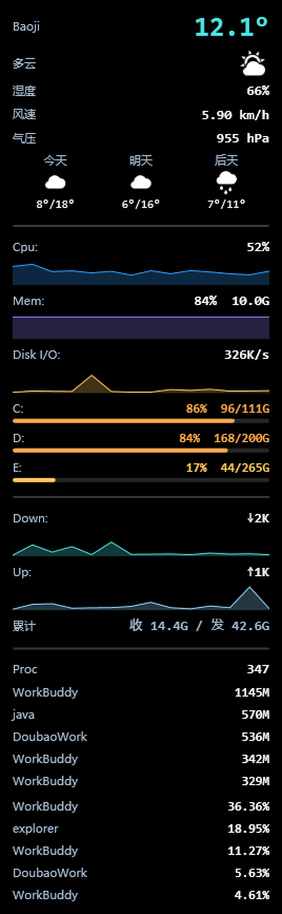

# ConkyWin

Windows 版 [Conky](https://github.com/brndnmtthws/conky) 式桌面系统监控挂件。背景 100% 透明、数据直接悬浮在桌面上，**嵌入桌面层**（不置顶、不挡鼠标、不抢焦点），支持开机自启。

纯 C# / WPF 实现，零第三方监控软件依赖（不需要 Rainmeter、LiteMonitor 等），单文件运行，体积小。



## 功能

| 行 | 内容 | 数据来源 |
|---|---|---|
| SYSTEM | 时钟 HH:mm:ss | 系统时间 |
| CPU | 占用率 + 渐变进度条 | Performance Counter |
| MEM | 已用 / 总量 + 进度条 | `GlobalMemoryStatusEx` |
| DISK | C: 已用 / 总量 + 进度条 | `DriveInfo` |
| NET | ↓下行 ↑上行 速率（>1M 自动显示 M） | `NetworkInterface` 流量差分 |
| GPU | 占用率 / 显存 / 温度 + 进度条 | `nvidia-smi`（每 2 秒采样） |
| TEMP | CPU 温度（普通权限不可读，显示 `--℃`） | 见下方"已知限制" |
| PROC | 进程数 | Performance Counter |

## 特性

- **真透明**：WPF per-pixel alpha，无任何底板
- **点击穿透 + 压底**：`WS_EX_TRANSPARENT | WS_EX_LAYERED`，嵌入桌面层（壁纸之上、图标之下），鼠标可正常操作下方图标；每 15 秒自动校正 Z 序，防止被其他程序顶掉
- **不抢焦点 / 不进任务栏**：`WS_EX_TOOLWINDOW`
- **配置热重载**：exe 同目录的 `config.json` 和 `script.lua` 保存后立即生效，无需重启（轮询修改时间实现，兼容"写临时文件再改名"的编辑器保存方式）；解析失败自动保留上一份有效配置
- **无 GPU 也能跑**：NVIDIA GPU 检测失败时静默降级，其余各行不受影响
- **Lua 脚本扩展**：可自定义每行文本/配色/进度条，甚至整面板由脚本生成（见下文）
- **配置透传**：config.json 整表（含任意自定义键）通过 `conky.config()` 供脚本读取——改配置即改脚本参数，不用动代码

## 运行要求

- Windows 10 / 11
- [.NET 8 Desktop Runtime](https://dotnet.microsoft.com/download/dotnet/8.0)
- （可选）NVIDIA 显卡 + `nvidia-smi` 在 PATH 中，用于 GPU 行

## 使用

1. 下载 Release 或自行编译，得到 `ConkyWin.exe`
2. 双击运行，面板出现在屏幕右下（默认 1680,360），首次运行自动生成默认 `config.json`
3. 编辑 `config.json` 调整位置 / 字号 / 配色，保存即生效

### 开机自启（可选）

在注册表 `HKCU\Software\Microsoft\Windows\CurrentVersion\Run` 下新建字符串值：

```
名称：ConkyWin
数据：<你的路径>\ConkyWin.exe
```

## 配置文件 config.json

```jsonc
{
  "Position": {
    "X": 1680,                            // 面板位置（RightGap >= 0 时忽略 X）
    "Y": 360,
    "RightGap": -1                        // >= 0 时右对齐：X = 屏幕右缘 - 面板宽 - RightGap（0 = 紧贴右缘）
  },
  "PanelWidth": 220,                     // 面板固定宽度（px），高度自适应内容
  "FontSize": 13,                        // 数值字号
  "TimeFontSize": 15,                    // 时间字号
  "Bold": true,                          // 数值是否加粗
  "LabelColor": "#7A90AC",               // 左侧标签颜色（CPU/MEM/...）
  "BarBackground": "#26FFFFFF",          // 进度条底色（半透明）
  "Cpu": {
    "ValueColor": "#4DE3E0",             // 数值颜色
    "BarStart": "#4DE3E0",               // 进度条渐变起点
    "BarEnd": "#2F9EFF"                  // 进度条渐变终点
  },
  "Mem":   { "ValueColor": "#7FB0FF", "BarStart": "#6FA8FF", "BarEnd": "#9B7BFF" },
  "Disk":  { "ValueColor": "#FFC85C", "BarStart": "#FFC85C", "BarEnd": "#FF8A5C" },
  "Net":   { "ValueColor": "#8FD8FF" },
  "Gpu":   { "ValueColor": "#B78CFF", "BarStart": "#B78CFF", "BarEnd": "#7A5CFF" },
  "Temp":  { "ValueColor": "#FF6B6B" },
  "Proc":  { "ValueColor": "#EAF2FC" },
  "Weather": {
    "City": "",                          // 城市名（支持中文，如 "西安"），填了优先用地理编码定位
    "Lat": 999,                          // 经纬度；999 = 自动（先 City，再 IP 定位）
    "Lon": 999
  }
}
```

颜色支持 `#RRGGBB` 与 `#AARRGGBB`（带透明度）。`Net` / `Temp` / `Proc` 没有进度条，只需 `ValueColor`。`Weather` 仅在 Lua 脚本调用 `conky.weather()` 时使用。

## Lua 脚本（进阶）

参照 Linux Conky 的思路，ConkyWin 支持 Lua 脚本扩展（基于 [MoonSharp](https://github.com/moonsharp-devs/moonsharp)，纯托管实现，无原生 DLL 依赖）：

1. 把 [`script.example.lua`](script.example.lua)（最小示例）或 [`script.harmattan.lua`](script.harmattan.lua)（复刻 Linux Harmattan 主题：天气大字/图标/三列预报 + 历史曲线 + 累计流量 + Top 进程列表；顶部 `THEME = "color"/"mono"` 一键换肤）复制到 exe 同目录并改名为 `script.lua`
2. 保存即生效（热重载，无需重启）；删除 `script.lua` 即恢复内置面板

脚本在**安全沙箱**中运行（无 io/os 等模块），出错只写 `debug.log` 并自动回退内置面板，不会导致挂件崩溃。

### 两种模式

**增强模式**——不定义 `conky_rows()`，只定义钩子函数，覆盖内置面板中对应行的文本/颜色/进度条：

```lua
-- CPU 超 90% 数值变红
function conky_cpu_color(pct)
    if pct > 90 then return "#FF5C5C" end
end

-- 内存改显示百分比
function conky_mem_text(used_gb, total_gb, pct)
    return string.format("%.0f%%", pct)
end

-- CPU 进度条超 80% 后渐变转红
function conky_bar_color(name, pct)
    if name == "cpu" and pct > 80 then return {"#FFC85C", "#FF5C5C"} end
end
```

可用钩子：`conky_time_text` / `conky_cpu_text` / `conky_mem_text` / `conky_disk_text` / `conky_net_text` / `conky_gpu_text` / `conky_temp_text` / `conky_proc_text`，以及对应的 `conky_*_color` 与 `conky_bar_color(name, pct)`。

**完整模式**——定义 `conky_rows()` 返回行表，整面板由脚本生成，WPF 按行表动态渲染：

```lua
function conky_rows()
    return {
        { label = "S Y S T E M", text = conky.time("%H:%M:%S"), color = "#8FD8FF" },
        { label = "CPU", text = string.format("%.0f%%", conky.cpu()),
          color = "#4DE3E0", bar = conky.cpu(), bar_start = "#4DE3E0", bar_end = "#2F9EFF" },
        -- ...
    }
end
```

每行字段：`label` / `text` 必填；`color`、`bar`（0-100 进度）、`bar_start` / `bar_end`（渐变两端）、`graph`（0-100 数值数组，历史曲线面积图）、`graph_height`（曲线高度）、`hr`（分隔横线）、`gap`（空白间隔 px，用于分区留白）、`font_size`（本行字号）、`cells`（多列布局，见下）可选。

`cells` 渲染为一行等宽多列，每格 `{label, text, sub, color}` 三层（顶部小字 / 中间大字 / 底部小字），适合三天预报（星期 / 图标 / 温度）这类并排内容：

```lua
rows[#rows + 1] = {
    cells = {
        { label = "今天", text = "☁︎", sub = "8°/18°" },
        { label = "明天", text = "⛅︎", sub = "6°/16°" },
        { label = "后天", text = "🌧︎", sub = "7°/11°" },
    }
}
```

速率类曲线建议**自适应满格量**（峰值放大、滞后收缩），否则流量几 K 时曲线是条直线——参考 `script.harmattan.lua` 里的 `autoscale()` 实现。

### 自定义配置：conky.config() 透传

config.json 会整体解析成 Lua 表，**包括任何你在里面自定义的键**。脚本可以直接把配置当参数用——改配置即改脚本行为，完全不用动代码：

```lua
local cfg = conky.config()
local floor_kb = cfg.ScaleFloorKb or 16   -- 在 config.json 里加 "ScaleFloorKb": 32 即可覆盖
local top_n    = cfg.TopProcesses or 5
local my_note  = cfg.MyNote               -- 任何键都能读
```

### 脚本可用 API

| 函数 | 返回 |
|---|---|
| `conky.cpu()` | CPU 占用 0-100 |
| `conky.mem_pct()` / `mem_used_gb()` / `mem_total_gb()` | 内存 |
| `conky.disk_pct()` / `disk_used_gb()` / `disk_total_gb()` | C: 盘 |
| `conky.disk_io_kb()` | 全盘读写速率 KB/s |
| `conky.net_down_kb()` / `conky.net_up_kb()` | 网速 KB/s |
| `conky.net_total_down_gb()` / `net_total_up_gb()` | 开机以来累计收/发流量 GB |
| `conky.top_mem(n)` / `top_cpu(n)` | 进程列表 `{name, mem_mb, cpu}`（每 3 秒采样） |
| `conky.gpu_util()` / `gpu_temp()` / `gpu_mem_used_gb()` / `gpu_mem_total_gb()` | GPU |
| `conky.gpu_available()` | GPU 是否可用 |
| `conky.proc()` | 进程数 |
| `conky.time(fmt)` | 当前时间（.NET 格式串，如 `"%H:%M:%S"`） |
| `conky.config()` | config.json 整表（含自定义键） |
| `conky.weather()` | 天气表 `{city, temp, humidity, wind, pressure, code, daily[3]={code,min,max}}`，数据来自 [Open-Meteo](https://open-meteo.com)（免费无 key）；定位顺序：config 的 Lat/Lon > City > IP 自动定位；成功后有本地缓存，重启不用重等 |
| `conky.weather_error()` | 最近一次天气获取失败的原因（成功后为空串） |
| `conky.font_size()` / `conky.time_font_size()` | config.json 中的字号 |

## 编译

需要 .NET 8 SDK：

```powershell
dotnet build ConkyWin.csproj -c Release -o out
```

产物在 `out\ConkyWin.exe`。

## 已知限制

- **CPU 温度**：普通权限下 Windows 没有可用的读取通道（WMI `MSAcpi_ThermalZoneTemperature` 拒绝访问；真实温度需要 Ring0 内核驱动 + 管理员权限，而管理员权限会破坏本程序依赖的桌面嵌入机制）。TEMP 行因此固定显示 `--℃`。GPU 温度通过 `nvidia-smi`（普通权限可读）正常显示。
- **磁盘**：默认只监控 C: 盘。

## Roadmap（欢迎 PR）

- [x] Lua 脚本扩展（增强模式 + 完整模式）
- [x] 显示行开关（通过 Lua 完整模式即可自由增删行）
- [x] 历史曲线图 / 磁盘 IO / 天气（`script.harmattan.lua`）
- [x] 速率曲线自适应满格量
- [ ] 多盘监控
- [ ] 多屏位置记忆
- [ ] 管理员模式下读取 CPU 温度（LibreHardwareMonitor 方案探索）

## License

[MIT](LICENSE)
